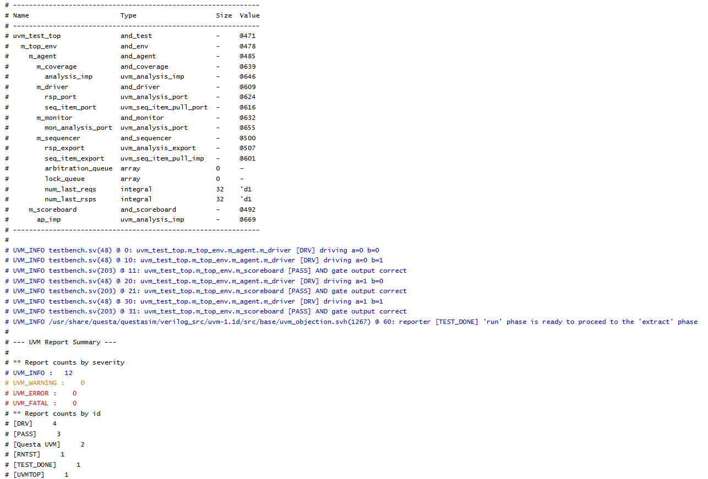

# SYSTEMVERILOG
This repo contains all the neccesary files that helped me learn systemverilog effeciently.

OOPS used questa sim 
```
vlog *.sv
vsim -c work.tb
run -all
quit
```
RANDOMIZATION used verilotor
```
export VERILATOR_ROOT=$HOME/verilator
$VERILATOR_ROOT/bin/verilator_bin --binary --timing --top-module tb -Wno-WIDTHTRUNC *.sv
./obj_dir/Vtb
```
CONSTRAINTS used verilotor
```
export VERILATOR_ROOT=$HOME/verilator
$VERILATOR_ROOT/bin/verilator_bin --binary --timing --top-module tb -Wno-WIDTHTRUNC *.sv
./obj_dir/Vtb
```

FUNCTIONAL COVERAGE used verilotor
```
export VERILATOR_ROOT=$HOME/verilator
$VERILATOR_ROOT/bin/verilator_bin --binary --timing --top-module tb -Wno-WIDTHTRUNC *.sv
./obj_dir/Vtb
```
ASSERTIONS used questa sim 
```
vlog *.sv
vsim -c work.tb
run -all
quit
```
INTERFACE used questa sim 
```
vlog *.sv
vsim -c work.tb
run -all
quit
```

INTERPROCESS COMMUNICATION used questa sim 
```
vlog *.sv
vsim -c work.tb
run -all
quit
```

UVM used EDA PLAYGROUND


